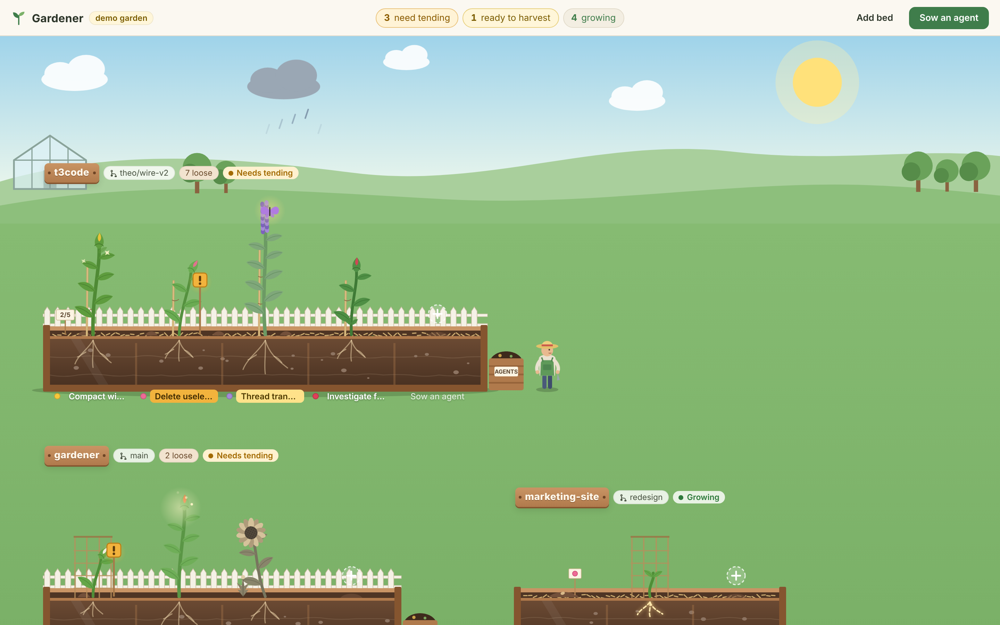
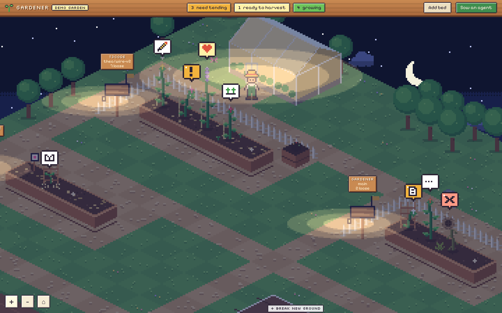
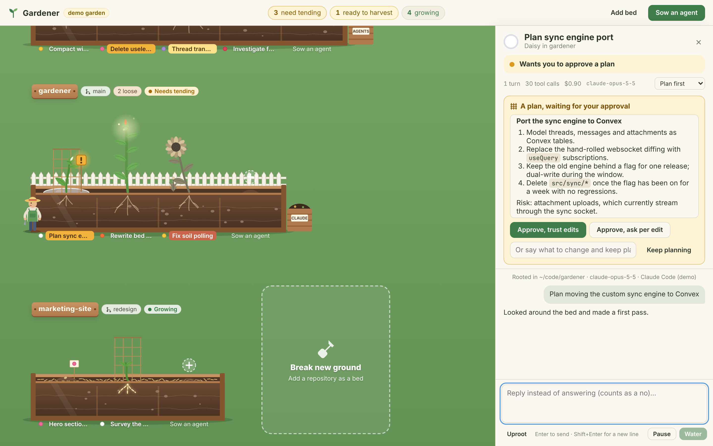

# Terrarium

A desktop garden for your Claude Code agents.

Every **repository is a bed**. Every **agent is a plant** growing in it. **You are the gardener**: you don't write the code yourself, you keep the beds healthy so the plants grow straight, you answer them when they need you, and you pull the weeds before they spread.



**[Try it in your browser](https://terrarium-td.vercel.app)** · **[Download for Windows / macOS / Linux](https://github.com/tanvishdesai/Terrarium-TD/releases/latest)**

The idea comes from Theo's "we're not really engineers anymore" argument. The job shifts from growing code to building the environment code grows well in: the right fertilizer (guidance), stakes to grow against (fast CI checks), and constant weeding (slop grows faster than weeds). Most "agents in a game world" UIs put agents in an office or a fantasy village. A garden fits better, because the thing you are really tending is the repo, not the agents.

## The look

Retro isometric pixel art, in the spirit of 90s park and hotel sims. The garden is a floating island drawn on a 2:1 isometric tile grid at true pixel resolution, then scaled up by a whole number (2x to 5x) so every pixel stays a crisp square. Each repo gets its own allotment: a raised wooden planter, a path around it, a signpost with its name. The interface around it uses pixel fonts (Pixelify Sans, Silkscreen, VT323) and chunky windows with hard 2px borders.

## What you see

| In the garden | What it means |
| --- | --- |
| Seed packet on a stick | An agent that has not run yet |
| Height and number of leaves | How many turns it has completed |
| Closed bud, swaying | Working on a turn |
| Open flower | Finished its last turn |
| Butterfly + heart bubble | A finished turn you have not read yet ("ready to harvest") |
| Drooping, amber `!` / `?` / scroll bubble | Waiting on you: a permission, a question, or a plan to approve |
| Brown and wilted, weed beside it, rain cloud overhead, red `x` bubble | The last turn failed |
| Thought bubble icon | What it is doing right now: `…` thinking, book reading, magnifier searching, pencil editing, terminal running a command, globe on the web, sprouts for subagents, list for todos |
| Roots glowing across the soil | Reading or searching the code |
| Watering can pouring | Running a shell command |
| Sparkles | Editing files |
| Bee circling the flower | Fetching from the web or an MCP server |
| Little seedlings beside it | Subagents ("runners") at work |
| Trellis behind it | It is in plan mode |
| Gold flashing tile under it | It is selected |
| Terracotta pot with a branch tag | It runs in its own git worktree on that branch (the default for git repos) |
| Notches on the stem | Completed turns ("rings"), each a checkpoint you can diff or prune back to |
| Leaf tally `+42 −7` | Lines added and removed in its last turn |
| Paper tags | Review comments you tied to diff lines, sent with your next message |
| Harvest basket at the pot | Changes ready to commit |
| Market stall `#123` | An open pull request; the stake ribbon shows its checks (green / amber / red) |
| Leaning away from its stake | The bed's check command failed after its last turn |
| Wild flower with a dashed tag | A "volunteer": a Claude Code session running in a terminal |
| `zz` bubble | Waiting for a free pot: this machine's memory is full, so the message is queued |
| Seed tray "+N in the catalogue" | Older plants live in the Seed Catalogue list (`\`) |
| Clouds or rain in the sky | Approaching or at your usage limit |
| Map view (zoom out to 1) | Beds as blocks with status pips |

Each allotment also shows its **soil report**, read from the repo itself:

| Prop | Found when the repo has |
| --- | --- |
| Compost bin at the back corner | `CLAUDE.md`, `AGENTS.md` or similar agent guidance |
| Bamboo stake beside every plant | CI config (`.github/workflows`, …) |
| White picket fence along the back | Tests |
| Straw mulch on the soil | Lint or format config |
| Loose soil mounds, "N loose" on the sign | Uncommitted changes |
| Flag on the signpost | The bed's mood: fallow, sown, growing, needs tending, ready to harvest |

Click a signpost (or the bed's name tag) to see its soil report and **chores**: agents whose job is improving the bed for every agent after them (survey it, add compost, pull weeds, drive a stake).

The sky follows your local clock: dawn, day, dusk, and night (lanterns on the signposts and a glowing greenhouse). The gardener, in a straw hat, walks the paths to whatever you select.

Drag to look around, scroll to pan, Ctrl + scroll (or the + / − buttons) to zoom, and ⌂ to come back.





## Working in the garden

- **Pots (worktrees).** In a git repo, every new plant grows in its own pot: a git worktree on its own branch (`garden/<name>-<hex>`), kept under Terrarium's data folder. Parallel agents never edit the same files, and your checkout stays yours. Choose **In the bed** when sowing to share the working tree instead. An optional `terrarium.json` at the repo root prepares each pot: `{ "pot": { "copy": [".env"], "setup": "npm ci" } }`.
- **Rings (checkpoints).** Every turn is a growth ring with a git snapshot before and after, including changes made by shell commands. The **Rings** tab shows each ring's diff (unified or split, per file). From any ring you can:
  - **Prune back to here:** restore the files and continue the conversation from that point.
  - **Grow a new branch from here:** start a new pot from that ring.
  - **Tie a tag:** select diff lines and add a note; the note and the lines go out with your next message.
- **Harvest.** The **Harvest** tab walks through four steps:
  - review the changes;
  - draft a commit message in the repo's style;
  - commit (never straight onto the default branch) and push;
  - open a pull request through `gh`, or GitHub's compare page if `gh` isn't logged in.

  The PR's checks then show on the plant's stake.
- **Stakes.** Give a bed a check command, detected from the repo (`npm test`, `npm run typecheck`, `pytest`, `cargo test`, …). It runs after every turn that changed files. A plant whose check fails leans away from its stake, with **Ask the plant to fix it** one click away.
- **Volunteers.** Claude Code sessions you start in a terminal appear as wild flowers, read live from their transcripts. An optional hook (Settings → Terminal sessions) makes them update instantly and turn amber when they wait for your permission. It merges into `~/.claude/settings.json` and removes cleanly.
- **Seed Catalogue and search.** Only active plants stand in the ground. Every plant is in the Seed Catalogue (`\`), a list you can filter and walk with the keyboard. `Ctrl+K` searches plant names, branches and the text of every journal.
- **Almanac.** Cost and tokens per day, bed, model and plant, read from Claude Code's own transcripts. That covers your whole history, not just Terrarium's plants. Costs are Claude Code's estimates.
- **Memory-aware.** How many agents run at once is decided by this machine's free memory, not a fixed number. Extra messages wait for a free pot, and idle plants rest until you message them again.
- **Accessibility.** Settings → Accessibility has a text size (100%, 125% or 150%; it scales the toolbar, panels, windows and name tags, while the garden keeps its whole-number zoom), a light, dark or system theme, and a motion setting (follow the system, reduce, or allow). With reduced motion every plant, bubble, the weather and the gardener hold still and the camera jumps instead of gliding. A screen reader hears when a plant starts needing you, wilts, or blooms with a finished turn ("Tulip in t3code needs your permission to run a command"); bursts are grouped ("3 plants need you") and spaced at least 5 seconds apart, and the announcements can be turned off. Windows high contrast keeps every frame, button, chip and focus ring visible in the system colours.

## Running it

You need **Node 22.12 or newer**, git, and Claude Code logged in on this machine. Terrarium runs agents through the [Claude Agent SDK](https://www.npmjs.com/package/@anthropic-ai/claude-agent-sdk), which uses the bundled Claude Code and whatever account Claude Code is logged into. If you have never logged in, run `claude` once in a terminal and log in with your Claude subscription. If `ANTHROPIC_API_KEY` is set in your environment, Claude Code uses that instead.

The [GitHub CLI](https://cli.github.com) is optional; run `gh auth login` if you want to open pull requests from Terrarium.

```bash
npm install
npm run dev
```

The first run checks git, Claude Code and `gh`. It offers to import your existing Claude Code sessions and to watch terminal sessions. Then click **Break new ground**, pick a repo folder, and **Sow** an agent.

Terrarium keeps its data (a SQLite database, logs and pots) in the app's data folder (`%APPDATA%\Terrarium` on Windows). A garden from the first version is migrated automatically and kept as `*.v1.bak`. If you used it when it was called Gardener, it keeps using your existing `%APPDATA%\Gardener` folder, so your garden, pots and terminal hook carry over.

To preview the interface in a browser with simulated agents (no Electron, no Claude, nothing runs):

```bash
npm run demo
```

Then open http://localhost:5199. Add `?phase=night` (or `dawn`, `dusk`) for other times of day, or `?beds=100&plants=1000&live=30` for a large synthetic garden.

### Keyboard

| Key | Does |
| --- | --- |
| `s` | Sow an agent (in the selected bed) |
| `n` / `Shift+N` | Next / previous plant that needs you (oldest wait first) |
| `[` / `]` | Previous / next bed |
| `\` | Open or close the Seed Catalogue (`j` / `k` move, `Enter` opens) |
| `Ctrl+K` | Search plants, beds, branches and journals; run actions |
| `j` / `k` | Next / previous file in a diff |
| `Esc` | Close the top-most window or panel |
| `Enter` / `Shift+Enter` | In the message box: send / new line |

## How it works

```
src/
  shared/      types (the GardenApi contract) and garden vocabulary used by both processes
  main/        Electron main process
    index.ts         IPC handlers and service wiring; one instance per data folder
    events.ts        coalesces events into at most one renderer message every 17 ms
    store.ts, db.ts  SQLite (node:sqlite, WAL, FTS5): beds, plants, paged journals, rings, settings
    agents.ts        one Agent SDK session per plant: plant state, pots, rings, prune and fork
    pool.ts          memory-based limit on live Claude processes
    git.ts           every git/gh call, queued: worktrees, snapshots, diffs, commit, push, PRs
    harvest.ts       commit message, commit, push, pull request, PR watcher
    transcript.ts, history.ts  Claude Code transcript parsing and history import
    volunteers.ts    terminal sessions (transcript tailing + optional hook server)
    usage.ts         the Almanac: usage and cost from transcripts
    soil.ts, soilScheduler.ts, stakes.ts  repo hygiene, scheduled soil checks, stake runs
    logger.ts        rotating logs and the diagnostics report
  preload/     exposes the typed GardenApi as window.terrarium
  renderer/    React UI
    store.ts         renderer state, updated incrementally from batched events
    panels/          plant and bed panels, journal, Seed Catalogue, palette, rings, diffs, harvest, Almanac, settings
    iso/             the isometric pixel-art garden on a canvas (tiled ground cache, culling, map view)
    demo.ts          a scripted fake garden that speaks the same API, for `npm run demo`
docs/v2/       the V2 plan (decisions, budgets, deviations), signing and release guides
```

- **Sessions.** Each plant is a long-lived Claude Code session (`query()` with an async-iterable prompt), so follow-ups go to the same session. The session id is saved, so after a restart the next message resumes the conversation.
- **Asks.** Permissions, `AskUserQuestion` and plan approval (`ExitPlanMode`) arrive through `canUseTool` and appear as cards in the plant's panel. Replying in the message box while a card is open counts as "no, do this instead".
- **Permission modes** are shown as **Ask me** (`default`), **Trust edits** (`acceptEdits`), **Plan first** (`plan`) and **Wild growth** (`bypassPermissions`).
- **Your configuration** (settings, `CLAUDE.md` files, MCP servers, hooks) loads the same way it does in the CLI. In a pot, project settings come from the repo root (`projectConfigRoot`) while the agent works in the worktree.
- **Notifications.** When a plant needs you and the window is not focused, you get a system notification, and the taskbar badge counts plants needing you.
- **Drawing.** The garden draws only what is on screen, from cached tiles and sprites. It stops redrawing when nothing moves, pauses when the window is hidden, and holds still with the system's reduced-motion setting.

### Budgets

Measured on Windows with 100 beds, 1,000 plants and 30 live agents:

| Budget | Target | Measured |
| --- | --- | --- |
| Frame time, p95 | ≤ 16 ms | about 3 ms |
| Cold start | ≤ 1.5 s | about 0.9 s |
| Main-thread stalls under load, p99 | ≤ 50 ms | about 27 ms |

See [docs/v2/PLAN.md](docs/v2/PLAN.md) for every budget and design decision.

## Development

```bash
npm run typecheck    # TypeScript
npm test             # unit and integration tests, run on Electron's own Node (node:sqlite + FTS5)
npm run build        # main, preload and renderer bundles in out/
```

Run all three before calling a change done. Also available:

| Command | What it checks |
| --- | --- |
| `node scripts/e2e.mjs` | Smoke test of the real desktop app on temp data (after `npm run build`) |
| `npm run bench` | Frame time with a 1,000-plant garden in headless Edge (budget p95 ≤ 16 ms) |
| `npm run coldstart` | Cold start to an interactive 1,000-plant garden, after `npm run build` (budget ≤ 1.5 s) |
| `npm run soak` | 30 streaming agents: main-thread stalls p99 ≤ 50 ms and at most 60 renderer messages a second (`SOAK_SECONDS=600` runs it for 10 minutes) |
| `npm run dist:dir` | Unsigned unpacked Windows build in `dist/win-unpacked` |
| `npm run dist` | Signed Windows installer (needs the signing setup in [docs/v2/SIGNING.md](docs/v2/SIGNING.md)) |

Environment variables:

- `TERRARIUM_DEBUG=1` prints each Claude Code process's stderr.
- `TERRARIUM_USER_DATA=<folder>` runs Terrarium on a separate data folder.

CI (`.github/workflows/ci.yml`) gates on Windows; macOS and Linux run the typecheck and tests without gating.

## Not done yet

- **Signed builds.** The [releases](https://github.com/tanvishdesai/Terrarium-TD/releases/latest) are unsigned for now (the release notes say how to open them). Signed Windows builds need the OV code-signing certificate described in [docs/v2/SIGNING.md](docs/v2/SIGNING.md); the workflow for them is ready (`release.yml`, on `v*-signed` tags).
- **macOS and Linux are an unsigned beta.** Apple Silicon (`.dmg`) and Linux x64 (`.AppImage`) builds are on the releases page but lightly tested so far.
- **Pull requests on hosts other than GitHub.** Terrarium stops after the push there.
